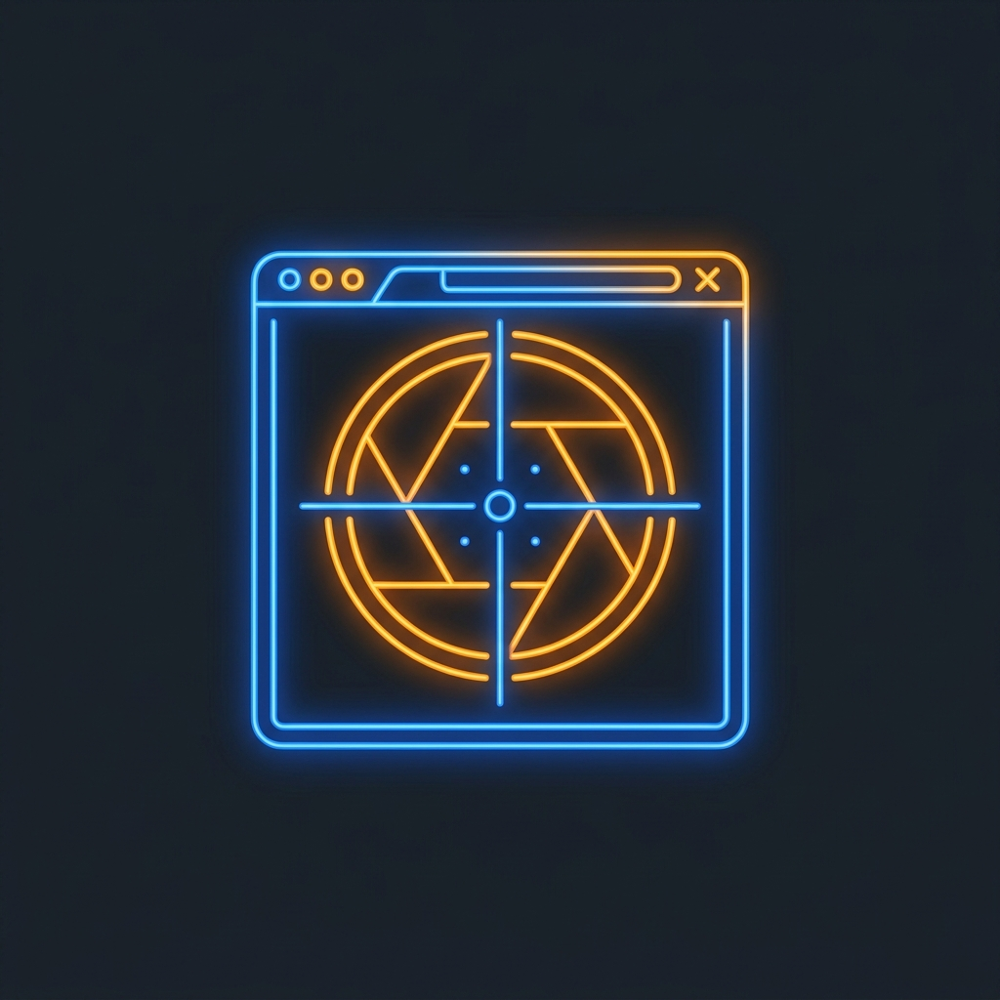

<p align="center">
  
</p>

<h1 align="center">Visual Tester & Browser Automation</h1>

<p align="center">
  <b>Automated Headless Browser Testing, Viewport Snapshots & WebGL/Canvas Verification for Google Antigravity</b>
</p>

---

## Overview

A web application or Three.js scene may compile with zero build errors while still being completely broken visually—whether through overlapping layouts, missing font assets, unhandled runtime exceptions, or a blank WebGL canvas context.

**Visual Tester** equips Antigravity with automated "eyes" to inspect actual rendered state in real headless Chromium browsers:
1. **Multi-Device Snapshots**: Captures desktop (1440x900), tablet (768x1024), and mobile (375x812) viewports.
2. **Three.js & Canvas Validation**: Confirms WebGL context initialization and captures time-stepped animation frames.
3. **Console & Asset Telemetry**: Traps unhandled JavaScript console errors and 404 resource drops.
4. **Antigravity Artifact Integration**: Automatically renders captured images directly inside the Antigravity review canvas.

---

## Capabilities

| Capability | What It Does | Benefit |
| :--- | :--- | :--- |
| **Responsive Snapshots** | Takes side-by-side screenshots across desktop and mobile viewports | Spots responsive CSS breaks and mobile navigation regressions |
| **WebGL & Canvas Check** | Verifies `<canvas>` context, catches shader compilation failures | Guarantees Three.js / WebGL scenes are rendering actual pixels |
| **Console Trapping** | Intercepts `window.onerror` and network error codes | Catches silent client-side errors that don't trigger build errors |
| **Gauntlet Loop Synergy** | Powers the blind A/B image comparison for `gauntlet-loop` | Provides real pixel-for-pixel benchmark comparisons |

---

## How to Use

### Trigger Commands
* `/visual-test http://localhost:3000`
* `verify in browser: http://localhost:8080`
* `take a screenshot of localhost: 3000`
* `test ui rendering for our checkout modal`

#### Example Prompt:
> `/visual-test Run a dev server on port 8080 for this Three.js project, take a desktop and mobile screenshot, and report any WebGL or console errors.`

---

## Installation

Clone this repository into your Antigravity plugins directory:

```bash
git clone https://github.com/davigmacode/visual-tester.git ~/.gemini/config/plugins/visual-tester
```

Restart Google Antigravity or your IDE to activate the plugin.

---

## Directory Structure

```text
visual-tester/
├── assets/
│   └── logo.png              # Viewport camera scanner emblem
├── skills/
│   └── visual-tester/
│       └── SKILL.md          # Headless browser scripts & verification logic
├── plugin.json               # Antigravity plugin manifest
└── README.md                 # Documentation
```

---

## License

MIT © [Irfan Vigma Taufik (davigmacode)](https://github.com/davigmacode)
